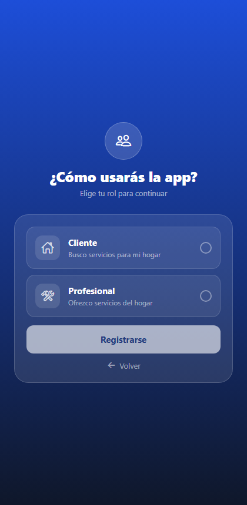

# Reporte de resultados — pruebas automatizadas ServiHogar 2.0

Generado: 9/11/2026, 6:36:40 p. m. · Herramienta: Playwright · Total: **21** · ✅ 20 · ❌ 1 · ⏭️ 0

> Nota: la preparación T00 (limpieza de datos) falló en esta ejecución; no afecta los resultados de las HU.

## Resultados por prueba

| ID | HU (Jira) | Criterios | Prueba | Resultado | Duración |
|---|---|---|---|---|---|
| T01 | HU-04 | CA-04 | T01 Login: enviar el formulario vacío muestra "Completa todos los campos" | ✅ Pasa | 3.3 s |
| T02 | HU-04 | CA-04 | T02 Login: con correo pero sin contraseña también exige completar los campos | ✅ Pasa | 1.9 s |
| T03 | HU-04 | CA-01 | T03 Login: el ícono del ojo muestra y oculta la contraseña | ✅ Pasa | 1.8 s |
| T04 | HU-01 | CA-01/CA-02/CA-03 | T04 Navegación: Login → Registro → Login | ✅ Pasa | 1.9 s |
| T05 | HU-01, HU-02 | CA-05 ; CA-03 | T05 Registro: campos vacíos → "Todos los campos son obligatorios" | ✅ Pasa | 2.1 s |
| T06 | HU-02 | CA-03/CA-04 | T06 Registro: contraseñas distintas → "Las contraseñas no coinciden" | ✅ Pasa | 2.0 s |
| T07 | HU-02 | CA-02/CA-04 | T07 Registro: contraseña de menos de 6 caracteres → mensaje de longitud mínima | ✅ Pasa | 2.0 s |
| T08 | HU-02 | CA-01/CA-04 | T08 Registro: un correo con formato inválido debe rechazarse en este mismo formulario | ❌ Falla | 12.6 s |
| T09 | HU-03 | CA-01/CA-02 | T09 Selección de rol: sin elegir rol el botón de registro está deshabilitado | ✅ Pasa | 2.2 s |
| T10 | HU-07, HU-08 | CA-02/CA-03 ; CA-01 | T10 Perfil profesional: el registro exige al menos un servicio y una descripción | ✅ Pasa | 2.4 s |
| T11 | HU-10, HU-39, HU-38 | CA-01/CA-03 ; CA-01 ; CA-01 | T11 Cliente: pantalla de bienvenida y pestañas propias del rol | ✅ Pasa | 5.8 s |
| T12 | HU-10, HU-39, HU-13 | CA-02/CA-03 ; CA-01 ; CA-01 | T12 Profesional: pantalla de bienvenida y pestañas propias del rol | ✅ Pasa | 6.6 s |
| T13 | HU-14, HU-11 | CA-01 ; CA-03 | T13 Cliente: la búsqueda ofrece las 14 categorías de servicio | ✅ Pasa | 6.0 s |
| T14 | HU-38 | CA-01/CA-04 | T14 Mensajes: la lista de chats carga sin errores de JavaScript | ✅ Pasa | 7.4 s |
| T15 | HU-06, HU-35 | CA-01/CA-02/CA-03 ; CA-04 | T15 Ajustes: cerrar sesión vuelve al login sin errores de navegación | ✅ Pasa | 6.1 s |
| T16 | HU-18, HU-20 | CA-01/CA-02/CA-04 ; CA-04 | T16 Cliente solicita un servicio y queda "Pendiente" en Mis servicios | ✅ Pasa | 10.7 s |
| T17 | HU-25, HU-24 | CA-01/CA-04 ; CA-02 | T17 Profesional acepta la solicitud (cotiza) y pasa a "En proceso" | ✅ Pasa | 8.7 s |
| T21 | HU-19 | CA-02/CA-03/CA-04 | T21 Cliente: con una solicitud activa, pedir otra al mismo profesional muestra "Solicitud existente" | ✅ Pasa | 7.1 s |
| T18 | HU-26 | CA-01/CA-03/CA-04 | T18 Profesional finaliza el servicio y el pago aparece en el historial del cliente | ✅ Pasa | 16.5 s |
| T19 | HU-27 | CA-02 | T19 Cliente: la ventana "Calificar servicio" no permite enviar sin elegir estrellas | ✅ Pasa | 8.7 s |
| T20 | HU-25 | CA-02/CA-05 | T20 Profesional rechaza con motivo y el cliente ve el rechazo | ✅ Pasa | 18.5 s |

## Cobertura de historias de usuario

**HU con al menos una prueba ejecutada: 21 de 41** (el profesor pide mínimo 15).

| HU | Jira | Título | Pruebas | Criterios verificados | Estado |
|---|---|---|---|---|---|
| HU-01 | SER-1 | Registrar usuarios | T04, T05 | 4 de 5 | ✅ sin fallos |
| HU-02 | SER-2 | Validar datos de registro | T05, T06, T07, T08 | 4 de 4 | ❌ con fallo |
| HU-03 | SER-3 | Selección rol | T09 | 2 de 3 | ✅ sin fallos |
| HU-04 | SER-4 | Iniciar sesión | T01, T02, T03 | 2 de 5 | ✅ sin fallos |
| HU-06 | SER-6 | Cerrar sesión | T15 | 3 de 4 | ✅ sin fallos |
| HU-07 | SER-7 | Seleccionar servicios profesionales | T10 | 2 de 4 | ✅ sin fallos |
| HU-08 | SER-8 | Registrar experiencia profesional | T10 | 1 de 4 | ✅ sin fallos |
| HU-10 | SER-10 | Mostrar navegación según perfil | T11, T12 | 3 de 4 | ✅ sin fallos |
| HU-11 | SER-11 | Visualizar resumen del cliente | T13 | 1 de 4 | ✅ sin fallos |
| HU-13 | SER-13 | Visualizar resumen profesional | T12 | 1 de 5 | ✅ sin fallos |
| HU-14 | SER-14 | Buscar profesionales | T13 | 1 de 3 | ✅ sin fallos |
| HU-18 | SER-18 | Solicitud de servicio | T16 | 3 de 4 | ✅ sin fallos |
| HU-19 | SER-19 | Evitar solicitudes duplicadas | T21 | 3 de 4 | ✅ sin fallos |
| HU-20 | SER-20 | Crear solicitud en Firestore | T16 | 1 de 6 | ✅ sin fallos |
| HU-24 | SER-24 | Consultar solicitudes profesionales | T17 | 1 de 4 | ✅ sin fallos |
| HU-25 | SER-25 | Aceptar o rechazar solicitud | T17, T20 | 4 de 5 | ✅ sin fallos |
| HU-26 | SER-26 | Finalizar servicios | T18 | 3 de 4 | ✅ sin fallos |
| HU-27 | SER-27 | Calificar servicios | T19 | 1 de 5 | ✅ sin fallos |
| HU-35 | SER-35 | Gestionar ajustes | T15 | 1 de 5 | ✅ sin fallos |
| HU-38 | SER-38 | Lista de chats | T11, T14 | 2 de 5 | ✅ sin fallos |
| HU-39 | SER-39 | Pantalla de bienvenida por rol | T11, T12 | 1 de 4 | ✅ sin fallos |

Sin ninguna prueba automatizada: HU-05, HU-09, HU-12, HU-15, HU-16, HU-17, HU-21, HU-22, HU-23, HU-28, HU-29, HU-30, HU-31, HU-32, HU-33, HU-34, HU-36, HU-37, HU-40, HU-41.

## Hallazgos (pruebas que fallaron)

> Antes de registrar un fallo como bug, abre su traza y confirma que no es un problema del localizador de la prueba.

### H-01 · T08 — T08 Registro: un correo con formato inválido debe rechazarse en este mismo formulario

- **Severidad:** _(Alta / Media / Baja)_
- **Tipo:** _(Funcional / Validación / UX / Seguridad)_
- **Resultado esperado:** _(según el criterio de aceptación)_
- **Resultado obtenido:**

```
Error: BUG: el registro deja avanzar a la selección de rol con un correo inválido

expect(locator).toHaveCount(expected) failed

Locator:  getByText('¿Cómo usarás la app?').visible()
Expected: 0
Received: 1
Timeout:  10000ms
```

- **Evidencias:**
  - 
  - [video](evidencias/01-acceso-y-registro-Acces-5862f-se-en-este-mismo-formulario/video.webm)
  - [error-context](evidencias/01-acceso-y-registro-Acces-5862f-se-en-este-mismo-formulario/error-context.md)
  - [trace](evidencias/01-acceso-y-registro-Acces-5862f-se-en-este-mismo-formulario/trace.zip)

